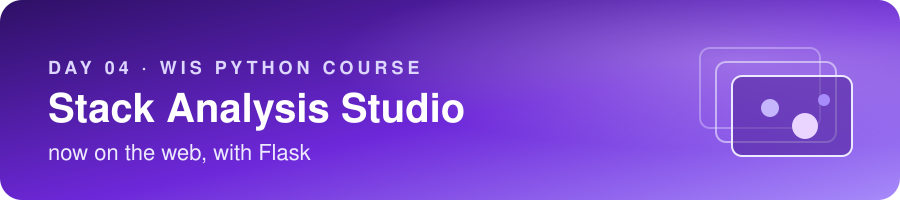

<p align="center">
  
</p>

<p align="center">
  
  
  
  
</p>

> 💜 **In one sentence:** I took my Day 03 desktop app for analysing 3D microscopy stacks and gave it a **web interface with Flask**. Both versions run the **same Python analysis code**.

---

## 🟣 The assignment

> Take a previous project, copy it to `day04`, and write a web application (e.g. with Flask) that uses its *business logic* and offers a web interface to it. Check that both the old and the new systems work.

✅ Copied · ✅ Flask web app · ✅ Same business logic · ✅ Both systems tested

---

## 🔮 What I built

| | 🖥️ Desktop (Day 03) | 🌐 Web (Day 04) |
|:--|:--|:--|
| **Start it** | `python run_app.py` | `python web_app.py` |
| **Open it** | Its own window | Any browser at http://127.0.0.1:5000 |
| **Image viewer** | napari | Slice images rendered by the server |
| **UI ⇄ Python** | Qt WebChannel | HTTP + JSON |
| **Analysis runs** | Inside the app | On the server |

What you can do in the browser:

- 💜 Load a sample stack (**synthetic blobs**, offline, or **cells3d**, real cells)
- 💜 Check and change the **calibration** (voxel size and unit)
- 💜 Run a **3D segmentation** and get object statistics
- 💜 Explore **z-profiles**, tables and charts. Click a point or row to jump to that slice
- 💜 Scroll slices with the **slider** or the **← / →** keys
- 💜 Download the **Markdown report**, the **CSV table** or the current slice as a **PNG**

---

## 🍇 How it works

```
   BROWSER                                SERVER  (Flask, web_app.py)
 ┌────────────────────┐   JSON / PNG   ┌──────────────────────────────────┐
 │ page, charts,      │ ◀────────────▶ │ routes /api/...                  │
 │ tables, slider     │     fetch()    │   ├─ analysis_service.py ◀─ shared with desktop
 └────────────────────┘                │   ├─ stack_analysis.py   ◀─ unchanged
                                       │   ├─ reporting.py        ◀─ unchanged
                                       │   └─ slice_render.py  → PNG of one slice
                                       └──────────────────────────────────┘
```

**The browser never does the maths.** It sends what you typed, and the server sends back numbers and pictures.

---

## 💡 The decisions I made

<table>
<tr><td>🟪 <b>Viewer</b></td><td>napari can't run in a browser, so the server <b>draws each slice as a PNG</b>, and the page shows it with a slider.</td></tr>
<tr><td>🟪 <b>Long analyses</b></td><td>A cells3d analysis takes ~15 s, so it runs as a <b>background job</b>. The page checks on it a few times a second and shows progress. The page never freezes.</td></tr>
<tr><td>🟪 <b>Shared logic</b></td><td>The input checking used to live inside the desktop window. I moved it to <code>analysis_service.py</code>, so <b>both apps use exactly the same code</b> and give the same results.</td></tr>
<tr><td>🟪 <b>Same look</b></td><td>I reused the Day 03 interface. Only the connection to Python changed.</td></tr>
<tr><td>🟪 <b>Scope</b></td><td>Kept the core features and downloads. Left out the 3D view and report import.</td></tr>
</table>

---

## 🚀 Run it

```bash
cd stack_analysis_studio
pip install -r requirements-web.txt
python web_app.py
```

Then open 👉 **http://127.0.0.1:5000**

<details>
<summary>💜 <b>Let other computers on the same network open it</b></summary>

```bash
python web_app.py --host 0.0.0.0
```

Then open `http://<this computer's IP>:5000` on the other computer. Press **Ctrl-C** to stop the server.
</details>

<details>
<summary>💜 <b>The old desktop app still works</b></summary>

```bash
python run_app.py
```
</details>

---

## 🧪 Proof that both work

| Check | Result |
|:--|:--|
| Web app tests (`test_web_app.py`) | 💜 7 / 7 passed |
| Web app in a real browser: load → analyse → tabs → downloads → reload → phone size | 💜 passed |
| Web and desktop give the **same results** | 💜 checked by a test |
| Desktop analysis tests (`test_stack_analysis.py`) | 💜 passed |
| Desktop napari test + full end-to-end test | 💜 passed |

---

## ⚠️ Good to know

- The server holds **one workspace**, so it's made for one person at a time.
- Flask's built-in server is for development. A real online server would use something like *gunicorn*.
- The measurements are estimates from classical image analysis, as in Day 03.

---

## 📚 More

- 🔍 Full technical details (API, every file, all decisions): [stack_analysis_studio/README.md](stack_analysis_studio/README.md)
- 📄 Plain-text summary: [SUMMARY.txt](SUMMARY.txt)
- 🧬 The original Day 03 app: [../day03](../day03/)

<p align="center"><sub>💜 Built with Claude (Opus 5.5) in VS Code. I made the design decisions, and Claude wrote and tested the code.</sub></p>
